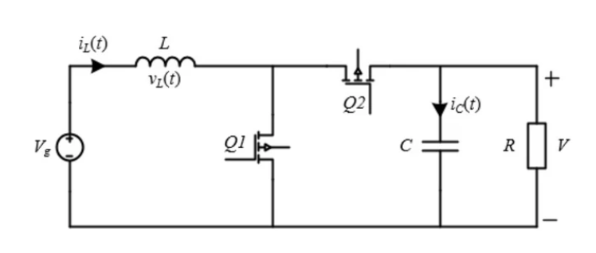

# Day 2：Buck、Boost 与 LDO 电源管理基础

## 一、Buck 降压电路

### 1. 基本结构

Buck（降压变换器）是一种将较高直流输入电压转换为较低直流输出电压的 DC-DC 变换器。

主要元件：
- MOSFET：开关管
- D：续流二极管
- L：储能电感
- C：输出滤波电容
- R：负载

### 2. 电路原理图


### 3. 工作原理

Buck 通过控制 MOSFET 的导通与关断，改变电感的储能和释放过程，实现降压。

- **MOSFET 导通：** 输入电源向电感和负载供电，电感储能，电感电流增大。
- **MOSFET 关断：** 电感通过续流二极管继续向负载供电，电感释放能量，电感电流减小。

### 4. 输出电压推导

利用电感伏秒平衡原理：稳态工作时，一个周期内电感电压的平均值为零。

导通阶段：

$$V_L=V_{in}-V_o$$

关断阶段：

$$V_L=-V_o$$

根据伏秒平衡：

$$D(V_{in}-V_o)+(1-D)(-V_o)=0$$

整理得到：

$$\boxed{V_o=DV_{in}}$$

因此，理想情况下：

$$\boxed{\frac{V_o}{V_{in}}=D}$$

**结论：** Buck 通过调节 MOSFET 的占空比 D 控制输出电压，占空比越大，输出电压越高。

> 以上推导基于理想器件、稳态连续导通模式（CCM）。

---

## 二、Boost 升压电路

### 1. 基本结构

Boost（升压变换器）是一种将较低直流输入电压转换为较高直流输出电压的 DC-DC 变换器。

主要元件：
- L1：储能电感
- S1：MOSFET 开关管
- D1：升压二极管
- C1：输出滤波电容
- RL：负载

### 2. 电路原理图



### 3. 工作原理

Boost 利用电感储能和释放能量的过程，实现升压。

- **MOSFET 导通：** 输入电源给电感储能，电感电流增大，二极管截止，此时主要由输出电容向负载供电。
- **MOSFET 关断：** 电感释放能量，与输入电源共同向输出端供电，二极管导通，电感电流减小。

MOSFET 导通期间，输出电容会向负载放电，因此需要合理选择开关频率和电容容量，减小输出电压波动。

### 4. 输出电压推导

利用电感伏秒平衡原理。

MOSFET 导通阶段：

$$V_L=V_{in}$$

MOSFET 关断阶段：

$$V_L=V_{in}-V_o$$

根据伏秒平衡：

$$DV_{in}+(1-D)(V_{in}-V_o)=0$$

整理得到：

$$\boxed{V_o=\frac{V_{in}}{1-D}}$$

因此，理想情况下：

$$\boxed{\frac{V_o}{V_{in}}=\frac{1}{1-D}}$$

**结论：** Boost 通过调节 MOSFET 的占空比 D 控制输出电压，占空比越大，理论输出电压越高。

> 以上推导基于理想器件、稳态连续导通模式（CCM）。

---

## 三、LDO 低压差线性稳压器

### 1. 基本概念

LDO（Low Dropout Regulator），即低压差线性稳压器。

它通过控制内部功率管的导通程度，利用负反馈实现稳定输出电压。

与 Buck、Boost 不同，LDO 不依靠电感储能和高频开关实现电压转换，而是通过功率管在线性区域工作实现稳压。

### 2. 电路原理图

以下直接采用原笔记中的 PMOS 型 LDO 电路图。


### 3. 主要组成部分

| 模块 | 功能 | 理解方式 |
|---|---|---|
| 电压基准 VREF | 提供稳定参考电压 | 给出目标 |
| 误差放大器 U1 | 比较 VFB 与 VREF | 判断偏差 |
| 功率管 Q1 | 调节输入到输出的电流 | 执行调整 |
| 反馈电阻 R1、R2 | 对输出电压进行分压 | 采样输出 |
| 输出电容 C1 | 滤波、提供瞬态电流 | 缓冲波动 |

### 4. 工作原理

R1、R2 对输出电压进行分压：

$$V_{FB}=V_{OUT}\frac{R_2}{R_1+R_2}$$

U1 比较 VFB 与 VREF，并通过输出端 UG 控制 PMOS 功率管 Q1。

正常稳压状态下：

$$V_{FB}\approx V_{REF}$$

因此：

$$\boxed{V_{OUT}=V_{REF}\left(1+\frac{R_1}{R_2}\right)}$$

**负反馈调节过程：**

- 输出电压降低 → VFB 降低 → U1 输出 UG 降低 → PMOS 导通增强 → 输出电压回升。
- 输出电压升高 → VFB 升高 → U1 输出 UG 升高 → PMOS 导通减弱 → 输出电压回落。

通过不断检测和调整，形成闭环稳压系统。

### 5. 压差（Dropout Voltage）

压差是指 LDO 为维持正常稳压所需要的最小输入输出电压差。

$$\boxed{V_{DO}=V_{IN(min)}-V_{OUT}}$$

例如，某 LDO 输出 3.3V，压差为 200mV，则：

$$V_{IN(min)}=3.3+0.2=3.5V$$

当输入电压低于这一要求时，LDO 进入压差状态，无法保证正常稳压。

压差通常与负载电流、温度及功率管特性有关。

### 6. 效率与功耗

LDO 通过功率管在线性区域工作实现稳压，输入输出之间的电压差会产生功率损耗。

$$P_{loss}=(V_{IN}-V_{OUT})I_{OUT}$$

忽略静态电流时，效率近似为：

$$\eta\approx\frac{V_{OUT}}{V_{IN}}$$

因此：
- 适合小压差、相对较小功率的稳压任务。
- 不适合直接承担大压差、大电流的主要供电任务。

---

## 四、Buck + LDO 组合架构

### 1. 基本思路

先使用 Buck 完成主要降压，再通过 LDO 进一步稳压和抑制部分电源纹波。

### 2. 架构示意

```text
输入电源
   │
   ▼
  Buck
   │
   ▼
中间电压（3.6V）
   │
   ▼
  LDO
   │
   ▼
低噪声输出（3.3V）
```

### 3. 组合优势

- Buck 转换效率较高，负责主要降压。
- LDO 进一步稳定输出，并在有效 PSRR 频段内抑制部分输入纹波。
- 避免 LDO 直接承受过大的输入输出压差。

适合对电源质量要求较高的模拟电路供电。

---

## 五、Boost + LDO 组合架构

### 1. 基本思路

当输入电压低于目标输出电压时，先使用 Boost 升压，再利用 LDO 进一步稳压。

### 2. 架构示意

```text
低压输入电源（2.5V）
       │
       ▼
     Boost
       │
       ▼
   中间电压（3.6V）
       │
       ▼
      LDO
       │
       ▼
   稳定输出（3.3V）
```

### 3. 组合优势

- Boost 解决输入电压不足的问题。
- LDO 进一步调节输出电压，抑制部分输入纹波。
- 兼顾升压能力与输出电源质量。

需要注意：Boost 的输出电压必须满足 LDO 的最低输入电压要求，同时还要考虑两级转换带来的功率损耗。

---

## 六、三种电源电路对比

| 对比项目 | Buck | Boost | LDO |
|---|---|---|---|
| 主要功能 | 降压 | 升压 | 线性稳压 |
| 核心器件 | MOS、电感、二极管 | MOS、电感、二极管 | 功率管、误差放大器 |
| 工作方式 | 高频开关 | 高频开关 | 线性调节 |
| 核心控制量 | 占空比 D | 占空比 D | 功率管导通程度 |
| 主要优势 | 转换效率高 | 转换效率高 | 输出噪声较低 |
| 主要不足 | 存在开关纹波 | 存在开关纹波 | 压差带来功率损耗 |

---

## 七、与激光雷达电源管理项目的联系

结合激光雷达电源管理与驱动芯片，可以初步建立以下认识：

1. **Buck：** 将系统输入电压转换为较低的中间供电电压。
2. **Boost：** 在输入电压不足时提供更高的供电电压。
3. **LDO：** 为模拟控制、参考电路等对电源噪声较敏感的模块提供较干净的电源。
4. **Buck + LDO：** 兼顾转换效率与后级电源质量。
5. **Boost + LDO：** 兼顾升压需求与后级稳压。

后续需要进一步研究：
- 脉冲负载下的电源瞬态响应。
- 电源纹波对激光脉冲稳定性的影响。
- 储能电容与去耦网络设计。
- 电源管理模块与激光驱动模块之间的协同工作。

**本日学习目标：** 理解 Buck、Boost、LDO 的基本工作原理，掌握各自的关键公式，并能够解释它们在激光雷达电源管理系统中的作用。
