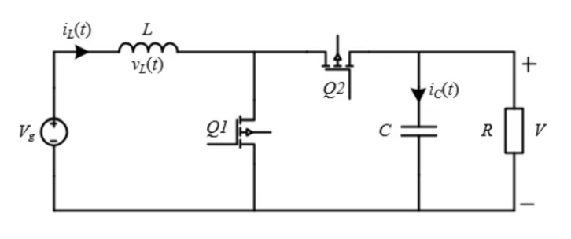
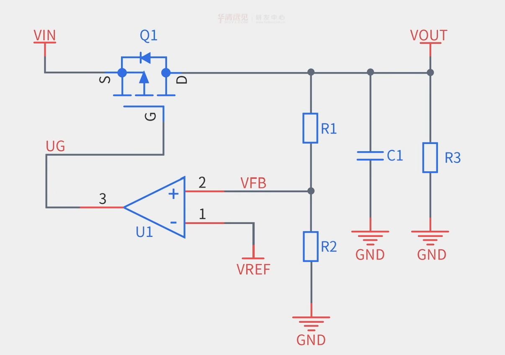

# Day 2：Buck、Boost 与 LDO 基础

## 1. Buck 降压电路

### 1.1 电路图

### 1.2 基本原理

Buck 是一种降压型 DC-DC 变换器，核心思想是通过 MOSFET 的周期性导通与关断，配合电感和电容，实现输出电压低于输入电压。

- MOS 导通时：输入电源向电感和负载供电，电感储能。
- MOS 关断时：电感通过续流二极管继续向负载供电，电感放能。

### 1.3 关键公式

导通阶段：

`VL = Vin - Vo`

关断阶段：

`VL = -Vo`

根据电感伏秒平衡：

`D * (Vin - Vo) + (1 - D) * (-Vo) = 0`

整理得到：

`Vo = D * Vin`

因此理想情况下：

`Vo / Vin = D`

### 1.4 结论

Buck 通过调节占空比 `D` 控制输出电压。

- `D` 越大，`Vo` 越高
- `D` 越小，`Vo` 越低

> 以上结论基于理想器件、稳态、连续导通模式（CCM）。

---

## 2. Boost 升压电路

### 2.1 电路图

### 2.2 基本原理

Boost 是一种升压型 DC-DC 变换器，核心思想是先让电感储能，再在开关关断时释放能量，与输入电源共同向输出端供电，从而实现输出电压高于输入电压。

- MOS 导通时：电感储能，输出端主要由电容给负载供电。
- MOS 关断时：电感放能，并与输入电源一起向输出端供电。

### 2.3 关键公式

导通阶段：

`VL = Vin`

关断阶段：

`VL = Vin - Vo`

根据电感伏秒平衡：

`D * Vin + (1 - D) * (Vin - Vo) = 0`

整理得到：

`Vo = Vin / (1 - D)`

因此理想情况下：

`Vo / Vin = 1 / (1 - D)`

### 2.4 结论

Boost 通过调节占空比 `D` 控制输出电压。

- `D` 越大，`Vo` 越高
- 理想情况下可实现升压

> 以上结论基于理想器件、稳态、连续导通模式（CCM）。

---

## 3. LDO 低压差线性稳压器

### 3.1 电路图

### 3.2 基本原理

LDO（Low Dropout Regulator，低压差线性稳压器）通过误差放大器和功率管构成负反馈闭环，实现稳定输出。

主要由四部分组成：

- 电压基准 VREF：提供参考电压
- 误差放大器 U1：比较 VFB 和 VREF
- 功率管 Q1：调节输入到输出的电流
- 反馈网络 R1、R2：对输出电压进行分压采样

### 3.3 工作逻辑

反馈关系：

`VFB = VOUT * R2 / (R1 + R2)`

稳压状态下：

`VFB ≈ VREF`

因此输出电压为：

`VOUT = VREF * (1 + R1 / R2)`

调节规律：

- 当 `VOUT` 降低时，`VFB` 降低，U1 调整 Q1 导通增强，使 `VOUT` 回升
- 当 `VOUT` 升高时，`VFB` 升高，U1 调整 Q1 导通减弱，使 `VOUT` 回落

### 3.4 压差（Dropout Voltage）

LDO 的压差是指：为了维持正常稳压，输入电压至少要比输出电压高出的那一部分电压。

`Vdo = Vin(min) - Vout`

例如：

若某 LDO 输出 `3.3V`，压差为 `0.2V`，则其最低输入电压约为：

`Vin(min) = 3.5V`

### 3.5 结论

LDO 适合：

- 小压差
- 小到中等电流
- 对电源噪声要求较高的场景

LDO 不适合：

- 大压差
- 大电流主供电场景

因为其功耗近似为：

`Ploss = (Vin - Vout) * Iout`

---

## 4. Buck + LDO

### 4.1 基本思路

先用 Buck 完成主要降压，再用 LDO 进一步稳压和降低纹波。

例如：

- Buck：`12V -> 3.6V`
- LDO：`3.6V -> 3.3V`

### 4.2 优点

- Buck 负责高效率降压
- LDO 负责进一步稳定输出
- 适合对电源质量要求较高的模拟电路

---

## 5. Boost + LDO

### 5.1 基本思路

当输入电压低于目标输出电压时，先用 Boost 升压，再用 LDO 稳压。

例如：

- Boost：`2.5V -> 3.6V`
- LDO：`3.6V -> 3.3V`

### 5.2 优点

- 解决输入电压不足的问题
- 同时兼顾升压与稳压

---

## 6. 总结

| 电路 | 作用 | 核心特点 |
|---|---|---|
| Buck | 降压 | 效率高，适合把高电压变低 |
| Boost | 升压 | 效率高，适合把低电压变高 |
| LDO | 稳压 | 结构简单、噪声较低，但效率受压差影响 |

### 项目中的理解

- Buck：适合提供较低中间电压
- Boost：适合输入不足时升压
- LDO：适合给模拟控制、参考电路等提供较干净的电源
- Buck/LDO、Boost/LDO 组合：兼顾效率和电源质量
