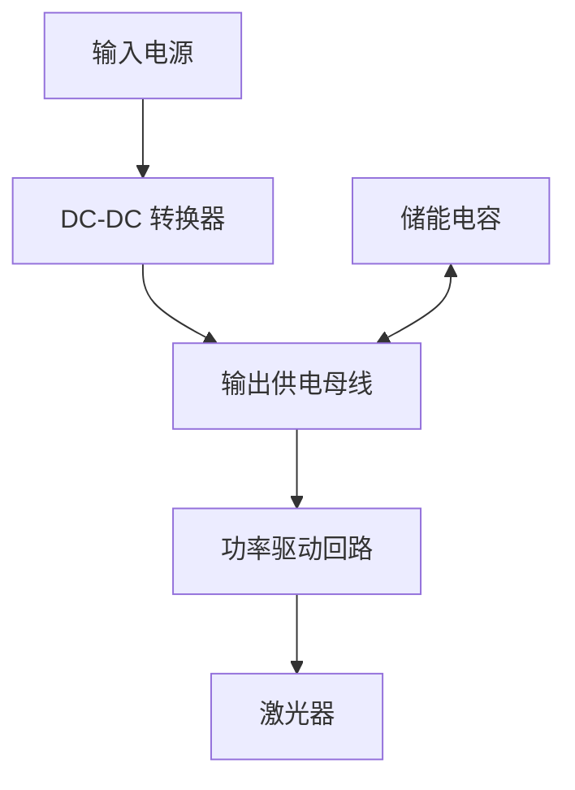

储能电容设计与脉冲负载供电

---

**当激光器需要在极短时间内获得较大的峰值电流时，电源应该如何提供能量？**

主要研究：

1. 为什么需要储能电容？
2. 如何计算储能电容的容量？
3. 为什么实际电容不能只看标称容量？
4. ESR 和 ESL 会带来什么影响？
5. 如何改善电容的高频性能？
6. 如何保证电容在重复脉冲下及时恢复能量？

# 第一部分：储能电容

## 1. 储能电容的作用

激光雷达通常采用脉冲方式发射激光。

在激光发射的短暂时间内，激光器可能需要较大的瞬态电流。

但是，DC-DC 转换器的控制环路存在有限的响应速度，不能瞬间完成输出电流的调整。

因此，可以在功率驱动回路附近设置储能电容。

**储能电容的主要作用：提前储存电能，在激光发射的短暂时间内，为功率驱动回路提供较大的瞬态电流。**

区分两种电容：

- DC-DC 输出电容：主要保证转换器输出稳定，减小输出电压纹波。
- 储能电容：提前储存能量，在脉冲期间提供瞬态电流。

两者可以在具体电路中共同承担供电任务。

## 2. 储能电容在系统中的位置

工作过程：

1. DC-DC 转换器将输入电压转换为所需的供电电压。
2. 储能电容提前充电，储存能量。
3. 激光器需要发射时，功率驱动回路开始工作。
4. 储能电容在短时间内释放能量，补充瞬态电流。
5. 脉冲结束后，DC-DC 转换器重新为电容补充能量。

这里的关键在于：

DC-DC 负责持续提供能量，储能电容负责补充瞬态功率需求。

## 3. 电容储能公式

电容储存的能量为：

$$
E_C=\frac{1}{2}CV^2
$$

其中：

- $E_C$：电容储存的能量，单位 J。
- $C$：电容容量，单位 F。
- $V$：电容两端电压，单位 V。

可以看出：

- 电容容量越大，储存的能量越多。
- 电容电压越高，储存的能量越多。

因此，储能电容的充电电压也是一个非常重要的设计参数。

## 4. 如何估算所需的储能电容？

从电容的基本关系出发：

$$
i_C=C\frac{dV_C}{dt}
$$

当电流近似恒定时：

$$
I=C\frac{\Delta V}{\Delta t}
$$

整理得到：

$$
\boxed{C=\frac{I\Delta t}{\Delta V}}
$$

其中：

- $I$：需要电容提供的电流。
- $\Delta t$：放电持续时间。
- $\Delta V$：允许的电容电压下降。

### 例题

假设：

- 激光器需要的瞬态电流为 $2A$；
- 脉冲宽度为 $20ns$；
- 允许电容电压下降 $0.2V$。

暂时假设整个脉冲电流均由理想电容提供。

代入公式：

$$
C=\frac{2\times20\times10^{-9}}{0.2}
$$

得到：

$$
\boxed{C=200nF}
$$

因此，理想情况下至少需要 $200nF$ 的电容。

注意：这只是初步估算。实际设计还需要考虑 DC-DC 转换器在脉冲期间承担的电流比例，不能直接把负载总电流全部视为电容提供的电流。

## 5. 电容容量并非简单的越大越好？

增大电容容量确实可以减小脉冲放电时的电压下降，但也会带来其他问题：

1. 充电时间可能增加。
2. 启动时需要更大的充电能量。
3. 可能增加 DC-DC 转换器的负担。
4. 增大芯片面积和成本。
5. 可能影响电源控制环路的稳定性。

所以，电容设计实际上是在以下几个方面寻找平衡：

- 储能能力、充电速度、体积、成本、电源稳定性

# 第二部分：真实电容的 ESR 和 ESL

## 1. 为什么实际电容不等于理想电容？

理想电容只有一个电容量 $C$。

但真实电容内部存在寄生参数，主要包括：

- ESR：等效串联电阻。
- ESL：等效串联电感。

真实电容的简化等效电路：

实际等效模型还可以考虑电容介质的漏电阻。

对于高速脉冲电路，ESR 和 ESL 尤其重要。

## 2. ESR：等效串联电阻

ESR（Equivalent Series Resistance）是电容内部的等效串联电阻。

当电流流过 ESR 时，会产生电压降。

根据欧姆定律：

$$
\boxed{\Delta V_{ESR}=I\cdot ESR}
$$

例如：

假设：

- 电容电流为 $2A$；
- ESR 为 $10m\Omega$。

则：

$$
\Delta V_{ESR}=2\times0.01
$$

得到：

$$
\boxed{\Delta V_{ESR}=20mV}
$$

因此：

ESR 越大，在相同电流下产生的电压降越大。

对于需要较大瞬态电流的激光驱动电源，应尽可能选择 ESR 合适的电容。

## 3. ESL：等效串联电感

ESL（Equivalent Series Inductance）是电容内部及其连接结构表现出来的等效串联电感。

根据电感的基本关系：

$$
\boxed{V_L=L\frac{di}{dt}}
$$

其中：

- $L$：等效串联电感。
- $di/dt$：电流变化率。

假设：

- 寄生电感为 $1nH$；
- 电流在 $2ns$ 内从 $0A$ 增加到 $2A$。

则：

$$
\frac{di}{dt}=\frac{2}{2ns}
$$

因此：

$$
V_L=1nH\times1A/ns
$$

得到：

$$
\boxed{V_L=1V}
$$

这说明：

即使寄生电感只有 $1nH$，在非常快速的电流变化下，也可能产生明显的电压尖峰。

**高速脉冲电路不能只考虑电容容量，还必须考虑寄生电感。**

## 4. C、ESR、ESL 分别影响什么？

| 参数 | 主要影响 |
|---|---|
| C | 储能能力和电容电压变化 |
| ESR | 电流流过时产生的电阻压降 |
| ESL | 快速电流变化时产生的感应电压 |

记忆：

- C 决定能够储存多少能量。
- ESR 决定电流流过时产生多大的电阻压降。
- ESL 决定电流快速变化时产生多大的感应电压。

三者共同影响实际电源输出的稳定性。

# 第三部分：如何改善 ESR 和 ESL 带来的影响？

主要有三个方向。

## 1. 合理选择电容

不同类型的电容具有不同的特点。

| 电容类型 | 主要特点 | 常见应用 |
|---|---|---|
| 陶瓷电容 | 通常具有较低 ESR 和 ESL | 局部高频去耦 |
| 聚合物电容 | 可提供较大容量和较低 ESR | 需要较大容量和较低 ESR 的场景 |
| 铝电解电容 | 容量较大 | 较大容量的储能 |

需要注意：

陶瓷电容的有效容量可能受到直流偏压影响。

因此，不能只看标称容量，还需要结合具体型号的数据手册，查看实际工作电压下的有效容量。

## 2. 多个电容并联

多个电容并联可以提高总容量，也有机会降低等效 ESR 和 ESL。

理想情况下：

$$
C_{total}=C_1+C_2+\cdots+C_n
$$

例如，两个相同的 $100nF$ 电容理想并联：

$$
C_{total}=100nF+100nF
$$

$$
\boxed{C_{total}=200nF}
$$

但并联效果与以下因素密切相关：

- 电容封装。
- PCB 布局。
- 走线长度。
- 连接路径。
- 电容之间的寄生参数。

不能简单认为电容数量越多越好。

## 3. 优化 PCB 布局

对于高速激光驱动电源，PCB 布局非常重要。

主要优化方向：

1. 储能电容尽量靠近功率驱动回路。
2. 缩短大电流路径。
3. 减小电流回路面积。
4. 减少不必要的过孔和长走线。
5. 优化功率地回流路径。

为什么要这样做？

因为 PCB 走线和过孔也会产生寄生电感。

当脉冲电流快速变化时：

$$
V_L=L\frac{di}{dt}
$$

如果回路寄生电感较大，就可能产生较大的电压尖峰。

因此，优化 PCB 布局实际上也是在降低功率回路的寄生电感。

**核心思想：缩短大电流路径，减小电流回路面积，降低寄生参数带来的影响。**

# 第四部分：储能电容如何重新充电？

激光雷达通常需要重复发射激光。

因此，储能电容不能只考虑第一次放电，还必须考虑两次脉冲之间能否及时恢复能量。

## 1. 每次脉冲消耗电荷

根据电流与电荷的关系：

$$
Q=I\Delta t
$$

其中：

- $Q$：转移的电荷量。
- $I$：电流。
- $\Delta t$：电流持续时间。

对于近似矩形的激光电流脉冲：

$$
Q_p=I_{peak}t_p
$$

其中：

- $I_{peak}$：峰值电流。
- $t_p$：脉冲宽度。

## 2. 平均需要的充电电流

假设脉冲重复频率为 $f$。

每秒发射 $f$ 次，每次需要补充 $Q_p$ 的电荷。

因此：

$$
\boxed{I_{avg}=Q_pf}
$$

代入：

$$
Q_p=20nC
$$

$$
f=100kHz
$$

得到：

$$
I_{avg}=20nC\times100kHz
$$

$$
\boxed{I_{avg}=2mA}
$$

也可以直接写成：

$$
\boxed{I_{avg}=I_{peak}t_pf}
$$

定义脉冲占空比：

$$
D=t_pf
$$

则：

$$
I_{avg}=I_{peak}D
$$

## 3. 为什么平均电流不能代表峰值电流？

这里需要建立一个非常重要的认识：

**瞬态峰值电流和长期平均供电能力是两个不同的设计指标。**

例如：

激光器可能需要 $2A$ 的瞬态峰值电流，但经过计算，平均补充电流只有 $2mA$。

不能因此认为电源只需要提供 $2mA$。

因为：

- 激光发射期间需要较大的瞬态电流。
- 电容需要在有限时间内恢复能量。
- DC-DC 转换器有自身的输出电流限制。
- 电容充电过程中还存在其他损耗。

还需要考虑：

1. 充电时间窗口。
2. 充电电路效率。
3. 电容电压。
4. 驱动电路的其他损耗。
5. 可能存在的偏置电流。
6. 多通道同时发射的情况。

因此：

**DC-DC 转换器不仅要能够提供足够的能量，还需要满足重复脉冲下的充电速度要求。**

# 第五部分：关键公式汇总

## 1. 电容储能

$$
E_C=\frac{1}{2}CV^2
$$

## 2. 电容基本关系

$$
Q=C\Delta V
$$

## 3. 储能电容容量估算

$$
C=\frac{I\Delta t}{\Delta V}
$$

## 4. ESR 电压降

$$
\Delta V_{ESR}=I\cdot ESR
$$

## 5. ESL 感应电压

$$
V_L=L\frac{di}{dt}
$$

## 6. 每次脉冲消耗的电荷

$$
Q_p=I_{peak}t_p
$$

## 7. 平均充电电流

$$
I_{avg}=Q_pf
$$

## 8. 脉冲占空比

$$
D=t_pf
$$

## 9. 矩形脉冲平均电流

$$
I_{avg}=I_{peak}D
$$

---

# 第六部分：学习总结

今天主要解决了三个问题。

## 1. 为什么需要储能电容？

激光器在发射瞬间需要较大的峰值电流，而 DC-DC 转换器的瞬态响应速度有限。

储能电容可以提前储存能量，在脉冲期间提供瞬态电流。

## 2. 为什么实际电容不能只看容量？

真实电容还存在 ESR 和 ESL。

- ESR 会造成电阻压降。
- ESL 会在快速电流变化时产生感应电压。

因此，实际设计还需要关注电容类型、封装和 PCB 布局。

## 3. 为什么需要考虑重复脉冲？

储能电容每次放电后都需要重新充电。

因此，电源管理不仅需要满足单次脉冲的峰值功率需求，还需要满足长期重复发射时的平均能量需求和充电速度要求。

最终需要实现：

**在激光器发射期间提供足够的瞬态能量，并在两次发射之间及时恢复电容储能。**

---

5. 如何兼顾供电稳定性、转换效率、芯片面积和成本？

**最终目标：为激光器提供稳定、可靠的能量供应，保证脉冲发射期间的电源电压和电流满足系统要求。**
