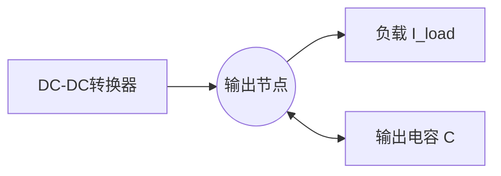
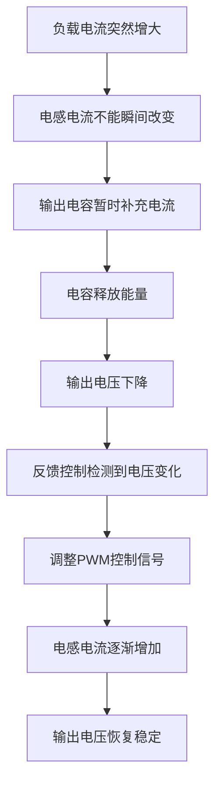
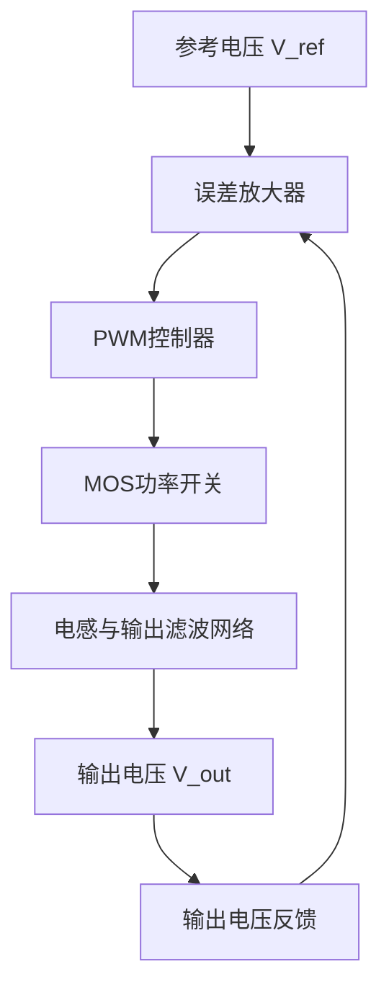
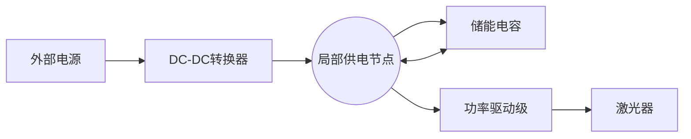

# 脉冲负载下的电源瞬态响应

## 一、负载瞬态响应（Load Transient Response）

### 1.1 什么是负载瞬态响应？

在普通电源系统中，我们通常关注输出电压是否稳定。

但是，在激光雷达系统中，激光器通常采用脉冲方式工作，驱动电路的负载会在不同工作状态之间快速切换。

例如：

- 不发射激光时，负载相对较小；
- 发射激光时，负载电流突然增大；
- 发射结束后，负载电流又迅速减小。

因此，电源不仅需要具有稳定的稳态输出能力，还需要具备良好的动态响应能力。

**负载瞬态响应（Load Transient Response）**，指的是负载发生突然变化时，电源输出电压产生波动，并最终恢复稳定的过程。

### 1.2 负载突然增大，为什么输出电压会下降？

首先考虑一个基本的DC-DC输出电路：



在输出节点，根据基尔霍夫电流定律：

$$
I_L=I_C+I_{load}
$$

整理得到：

$$
\\boxed{I_C=I_L-I_{load}}
$$

其中：

- $I_L$：DC-DC转换器提供的电流；
- $I_C$：输出电容电流；
- $I_{load}$：负载电流。

这里需要注意电容电流的正方向：$I_C$ 为正表示电容充电，为负表示电容放电。

假设原本电源提供的电流与负载电流相等：

$$
I_L=I_{load}
$$

因此：

$$
I_C=0
$$

此时电容不需要额外提供电流。

现在假设负载电流突然增加，而DC-DC转换器的电感电流不能瞬间变化。

例如：

原本：

$$
I_L=1A
$$

$$
I_{load}=1A
$$

突然负载电流增加到：

$$
I_{load}=2A
$$

而电感电流暂时仍然保持：

$$
I_L\\approx1A
$$

那么：

$$
I_C=1-2=-1A
$$

这说明电容需要向负载提供1A电流。

**结论：负载突然增大时，输出电容会暂时释放能量，补充电源来不及提供的电流，因此输出电压会下降。**

### 1.3 负载瞬态响应的基本过程



可以将这个过程分为三个阶段：

1. **负载突变阶段：** 负载电流突然增加，电源输出电流暂时跟不上。
2. **电容放电阶段：** 输出电容释放能量，补充负载所需电流，输出电压出现跌落。
3. **恢复阶段：** DC-DC控制电路调整工作状态，增加能量传递，输出电压逐渐恢复。

示意波形：

```text
负载电流 I_load：

        ┌────────────────
________│

电感电流 I_L：

                  /──────
_________________/

输出电压 V_out：

─────────\
          \____/─────────
```

其中，输出电压下降的最低点称为欠冲（Undershoot），之后可能出现一定的过冲（Overshoot），最终逐渐恢复稳定。

---

## 二、电容如何改善瞬态响应？

### 2.1 电容的基本特性

根据电容的基本关系：

$$
i_C=C\\frac{dV_C}{dt}
$$

整理：

$$
\\frac{dV_C}{dt}=\\frac{i_C}{C}
$$

可以看出，在电流一定的情况下，电容容量越大，电压变化率越小。

因此，电容能够在负载突然增加时暂时提供电流，减小输出电压的下降幅度。

### 2.2 电容电压变化量的计算

假设电容在一段时间内提供近似恒定的电流，则：

$$
\\boxed{\\Delta V=\\frac{I\\Delta t}{C}}
$$

其中：

- $I$：电容提供的电流；
- $\\Delta t$：电容放电持续时间；
- $C$：电容容量。

**例题：**

假设：

- 电容需要提供的电流：1A；
- 持续时间：1us；
- 电容容量：100uF。

那么：

$$
\\Delta V=\\frac{I\\Delta t}{C}
$$

代入：

$$
\\Delta V=
\\frac{1\\times1\\times10^{-6}}
{100\\times10^{-6}}
$$

得到：

$$
\\boxed{\\Delta V=0.01V}
$$

即电容电压下降约10mV。

### 2.3 与激光驱动项目的联系

激光驱动可能需要较大的峰值电流，但脉冲持续时间很短。

因此，可以考虑通过局部储能电容提供瞬态能量，而不必要求DC-DC转换器直接响应每一个纳秒级脉冲。

需要注意：

电容提供的是有限的储能，实际设计还要考虑允许电压变化、ESR、ESL和重复充电能力。

---

## 三、ESR、ESL：实际电容的非理想特性

理想电容只考虑电容量 $C$。

但实际电容还存在等效串联电阻和等效串联电感。

- ESR：Equivalent Series Resistance，等效串联电阻。
- ESL：Equivalent Series Inductance，等效串联电感。

实际电容可以近似表示为理想电容与串联电阻、串联电感组成的等效电路。

### 3.1 ESR：等效串联电阻

电容内部存在一定的等效串联电阻。

当电流通过这个电阻时，会产生额外的电压降。

根据欧姆定律：

$$
\\boxed{\\Delta V_{ESR}=\\Delta I\\times ESR}
$$

例如：

假设：

- 电流变化量为 $2A$；
- 电容ESR为 $10m\\Omega$。

那么：

$$
\\Delta V_{ESR}=2\\times0.01
$$

得到：

$$
\\boxed{\\Delta V_{ESR}=20mV}
$$

这意味着，负载电流突然增加时，输出电压会因为ESR而产生一个瞬时变化。

因此：

- ESR越大，瞬时电压降通常越明显；
- ESR越小，电容在提供脉冲电流时的电压表现通常越好。

### 3.2 ESL：等效串联电感

实际电路中的电容引脚、PCB走线、封装和连接路径都会带来寄生电感。

根据电感的基本关系：

$$
V_L=L\\frac{di}{dt}
$$

可以看出，电流变化越快，寄生电感产生的电压变化越明显。

**例题：**

假设：

- 寄生电感为 $1nH$；
- 电流在 $2ns$ 内变化 $2A$。

那么：

$$
\\frac{di}{dt}=\\frac{2A}{2ns}
=1A/ns
$$

因此：

$$
V_L=L\\frac{di}{dt}
$$

$$
V_L=1nH\\times1A/ns
$$

得到：

$$
\\boxed{V_L=1V}
$$

可以看出，即使只有 $1nH$ 的寄生电感，在如此快速的电流变化下，也可能产生1V的电压变化。

这对高速激光驱动电路尤其重要。

因为激光器的驱动电流具有较快的上升和下降过程，供电回路中的寄生电感可能造成额外的电压尖峰。

**注意：不是只要电容容量足够大，电源就一定稳定。**

还必须考虑电容的ESR、ESL以及整个供电回路的寄生参数。

### 3.3 电容C、ESR、ESL分别影响什么？

| 参数 | 主要影响 |
|---|---|
| 电容C | 决定储能能力和电压下降速度 |
| ESR | 造成电流突变时的瞬时电压变化 |
| ESL | 在快速电流变化时造成额外电压尖峰 |

### 3.4 如何改善电源瞬态性能？

1. 选择合适容量的储能电容。
2. 选择低ESR、低ESL的电容。
3. 多个不同容量的电容合理并联。
4. 缩短电源与功率驱动之间的供电回路。
5. 优化PCB布局，降低寄生电感。
6. 优化DC-DC控制环路。

需要注意，电容并不是越大越好，还需要考虑启动时间、充电电流、成本和控制环路稳定性。

---

## 四、电源为什么不能瞬间响应？

### 4.1 DC-DC转换器的反馈控制

以Buck或Boost转换器为例，实际电路通常需要反馈控制系统来稳定输出电压。

典型的控制过程：



基本工作流程：

1. 通过反馈网络检测输出电压。
2. 将反馈电压与参考电压比较。
3. 误差放大器产生控制信号。
4. PWM控制器调整MOS管的占空比。
5. 转换器改变能量传递过程。
6. 输出电压逐渐恢复到目标值。

### 4.2 为什么这个过程需要时间？

假设输出电压突然下降。

控制电路检测到这个变化后，会调整占空比，使转换器增加能量传递。

但是，这个过程涉及：

- 反馈检测；
- 误差放大；
- 控制信号调整；
- PWM开关周期；
- 电感电流变化。

这些过程都需要时间。

尤其是电感电流不能瞬间改变，因此DC-DC转换器不可能像理想电流源一样瞬间响应任意大的负载变化。

### 4.3 为什么纳秒级激光脉冲特别依赖局部储能？

假设：

- 激光器需要一个持续时间为 $10ns$ 的电流脉冲；
- DC-DC转换器控制环路的响应时间明显长于 $10ns$。

那么，当激光脉冲开始时：

1. 功率驱动级需要瞬间获得较大的能量。
2. DC-DC转换器无法立即完成相应的输出电流调整。
3. 局部储能电容首先释放能量。
4. 激光脉冲结束。
5. DC-DC转换器在后续时间内补充电容释放的能量。

核心思路：

**储能电容负责快速响应，DC-DC转换器负责持续补充能量。**



其中：

- DC-DC转换器负责电能转换和电容充电；
- 储能电容负责提供瞬态能量；
- 功率驱动级负责控制放电过程；
- 激光器将获得的电能转化为光输出。

这是一种可能的系统架构，实际拓扑需要根据激光器参数和驱动方案确定。

---

## 五、脉冲负载下的平均电流计算

除了瞬时峰值电流，还需要关注脉冲负载的重复频率和平均电流。

假设：

- 峰值电流：2A；
- 脉冲宽度：10ns；
- 重复频率：100kHz；
- 脉冲之间电流近似为零。

### 5.1 计算脉冲周期

根据：

$$
T=\\frac{1}{f}
$$

代入：

$$
T=\\frac{1}{100kHz}
$$

得到：

$$
\\boxed{T=10\\mu s}
$$

### 5.2 计算占空比

根据：

$$
D=\\frac{t_{pulse}}{T}
$$

代入：

$$
D=\\frac{10ns}{10\\mu s}
$$

得到：

$$
\\boxed{D=0.001=0.1\\%}
$$

### 5.3 计算平均电流

对于理想矩形脉冲，且脉冲之间电流为零：

$$
I_{avg}=I_{peak}D
$$

代入：

$$
I_{avg}=2\\times0.001
$$

得到：

$$
\\boxed{I_{avg}=2mA}
$$

可以看出：

峰值电流是2A，但理想情况下平均电流只有2mA。

### 5.4 这个结果有什么意义？

这说明激光驱动系统需要同时考虑两个不同的问题：

**峰值电流需求：**

激光发射瞬间需要较大的电流，主要考验局部储能网络和功率驱动级的瞬态供电能力。

**平均能量需求：**

系统需要不断补充每次脉冲消耗的能量，主要考验DC-DC转换器的持续供电能力。

因此：

**DC-DC转换器需要满足系统的平均能量需求，而局部储能网络需要满足短时间内的峰值电流需求。**

实际设计还需要考虑：

- 激光器工作电压；
- 驱动电路损耗；
- DC-DC转换效率；
- 电容充电效率；
- 偏置电流；
- 脉冲重复频率。

注意：平均电流计算基于理想矩形脉冲，实际系统的输入电流还与电压转换比和效率有关，不能直接将负载平均电流等同于电源输入电流。

---

## 六、与激光雷达电源管理项目的联系

结合前面的内容，可以将今天学习的知识归纳为以下几个实际研究问题。

### 6.1 储能电容设计

需要研究：

- 如何根据峰值电流和脉冲宽度估算储能电容？
- 如何确定允许的电压下降范围？
- 如何选择低ESR、低ESL电容？
- 多个不同容量的电容应该如何组合？

### 6.2 供电网络优化

需要研究：

- 如何缩短储能电容到功率MOS之间的电流路径？
- 如何减小PCB走线和封装寄生电感？
- 如何降低电源输出端的电压尖峰？
- 如何保证功率驱动工作时供电电压稳定？

### 6.3 DC-DC动态响应

需要研究：

- 负载突然变化时，输出电压会产生多大波动？
- DC-DC转换器需要多长时间恢复稳定？
- 控制环路如何影响负载瞬态响应？
- 如何在响应速度与稳定性之间进行权衡？

### 6.4 脉冲重复工作能力

需要研究：

- 两次激光脉冲之间，储能电容能否完成补能？
- 重复频率提高后，电源需要提供多大的平均功率？
- 连续工作时，电容电压是否会逐渐下降？
- 电源能否长期维持稳定输出？

---

## 七、本日知识总结

今天主要学习了脉冲负载下的电源动态响应。

需要掌握的核心公式：

| 知识点 | 公式 |
|---|---|
| 节点电流关系 | $I_C=I_L-I_{load}$ |
| 电容基本关系 | $i_C=C\\frac{dV_C}{dt}$ |
| 电容电压变化 | $\\Delta V=\\frac{I\\Delta t}{C}$ |
| ESR电压降 | $\\Delta V_{ESR}=\\Delta I\\times ESR$ |
| ESL感应电压 | $V_L=L\\frac{di}{dt}$ |
| 脉冲周期 | $T=\\frac{1}{f}$ |
| 占空比 | $D=\\frac{t_{pulse}}{T}$ |
| 平均电流 | $I_{avg}=I_{peak}D$ |

### 三个最重要的认识

1. **电容是负载瞬态变化时的重要能量缓冲元件。** 当负载电流突然增大，电感电流无法瞬间跟上，输出电容会暂时释放能量。

2. **高速电源设计不能只关注电容容量。** ESR、ESL以及PCB寄生参数都会影响瞬态供电性能。

3. **DC-DC与局部储能网络需要协同工作。** DC-DC负责持续补充能量，局部储能网络负责满足快速变化的峰值电流需求。


