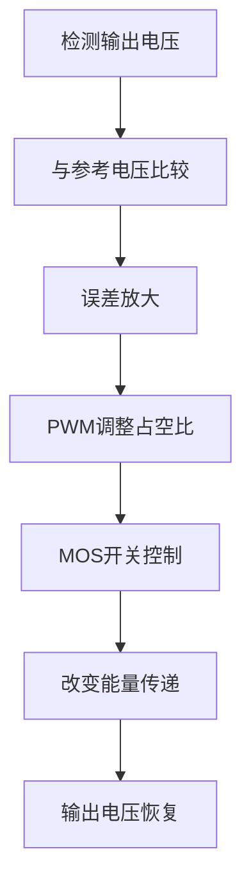

脉冲负载下的电源瞬态响应

## 一、负载瞬态响应

### 1. 什么是负载瞬态响应？

激光雷达采用脉冲发射方式，驱动电路的负载会发生快速变化：

- 不发射激光时，负载较小；
- 发射激光时，负载突然增大；
- 发射结束后，负载迅速减小。

负载发生突变时，电源输出电压会产生波动，之后逐渐恢复稳定，这个过程称为**负载瞬态响应**。

### 2. 为什么负载突然增大，输出电压会下降？

根据基尔霍夫电流定律：

$$
I_L=I_C+I_{load}
$$

整理：

$$
I_C=I_L-I_{load}
$$

其中：

- $I_L$：DC-DC转换器提供的电流；
- $I_C$：电容电流；
- $I_{load}$：负载电流。

当负载电流突然增加时，由于电感电流不能瞬间改变，DC-DC转换器无法立即提供额外电流。

此时输出电容开始放电，补充电源暂时无法提供的电流，导致输出电压下降。

### 3. 电容如何改善瞬态响应？

电容基本关系：

$$
i_C=C\frac{dV_C}{dt}
$$

假设电容提供恒定电流，则：

$$
\Delta V=\frac{I\Delta t}{C}
$$

**例：**

电容提供1A电流，持续1μs，容量为100μF。

$$
\Delta V=
\frac{1\times1\times10^{-6}}
{100\times10^{-6}}
$$

$$
\boxed{\Delta V=0.01V}
$$

因此，电容可以在负载突变时暂时提供能量，减小输出电压波动。

---

## 二、ESR与ESL

实际电容并不是理想元件，还存在等效串联电阻和等效串联电感。

- ESR：Equivalent Series Resistance，等效串联电阻。
- ESL：Equivalent Series Inductance，等效串联电感。

### 1. ESR

电容内部存在一定的串联电阻，电流流过时会产生电压降。

根据欧姆定律：

$$
\boxed{\Delta V_{ESR}=\Delta I\times ESR}
$$

例如，电流变化2A，ESR为10mΩ：

$$
\Delta V_{ESR}=2\times0.01
$$

$$
\boxed{\Delta V_{ESR}=20mV}
$$

因此，ESR越大，电流突变时产生的瞬时电压变化通常越明显。

### 2. ESL

电容引脚、PCB走线和封装都会产生寄生电感。

根据电感基本关系：

$$
V_L=L\frac{di}{dt}
$$

例如：

- 寄生电感：1nH；
- 电流在2ns内变化2A。

则：

$$
\frac{di}{dt}=\frac{2}{2ns}=1A/ns
$$

$$
V_L=1nH\times1A/ns
$$

$$
\boxed{V_L=1V}
$$

可见，即使只有1nH的寄生电感，在高速电流变化下也可能产生明显的电压尖峰。

### 3. 三者的区别

| 参数 | 主要影响 |
|---|---|
| 电容C | 储能能力和电压下降速度 |
| ESR | 电流突变时的瞬时电压变化 |
| ESL | 快速电流变化时产生的额外电压尖峰 |

### 4. 改善方法

1. 选择合适容量的储能电容。
2. 选择低ESR、低ESL电容。
3. 多个不同容量的电容合理并联。
4. 缩短供电回路。
5. 优化PCB布局，降低寄生电感。
6. 优化DC-DC控制环路。

---

## 三、电源为什么不能瞬间响应？

### 1. DC-DC反馈控制过程

DC-DC转换器通常通过反馈控制稳定输出电压。

基本过程：

1. 检测输出电压。
2. 将反馈电压与参考电压比较。
3. 误差放大器产生控制信号。
4. PWM控制器调整MOS管占空比。
5. 改变能量传递过程，使输出电压恢复稳定。

### 2. 为什么存在响应时间？

上述过程涉及：

- 反馈检测；
- 误差放大；
- 控制信号调整；
- PWM开关周期；
- 电感电流变化。

这些过程都需要时间。

因此，DC-DC转换器不能像理想电流源一样瞬间响应任意大的负载变化。

### 3. 为什么纳秒级激光脉冲特别依赖局部储能？

假设激光器需要一个10ns的电流脉冲，而DC-DC控制环路的响应时间明显长于10ns。

此时：

1. 激光驱动需要瞬间获得大量能量。
2. DC-DC无法立即完成输出电流调整。
3. 局部储能电容首先释放能量。
4. 激光脉冲结束。
5. DC-DC在后续时间内补充电容释放的能量。

**核心认识：储能电容负责快速响应，DC-DC负责持续补充能量。**

---

## 四、脉冲负载下的平均电流计算

假设：

- 峰值电流：2A；
- 脉冲宽度：10ns；
- 重复频率：100kHz；
- 脉冲之间电流近似为零。

### 1. 计算周期

$$
T=\frac{1}{f}
=\frac{1}{100kHz}
$$

$$
\boxed{T=10\mu s}
$$

### 2. 计算占空比

$$
D=\frac{t_{pulse}}{T}
$$

$$
D=\frac{10ns}{10\mu s}
$$

$$
D=0.001=0.1\%
$$

### 3. 计算平均电流

对于理想矩形脉冲：

$$
I_{avg}=I_{peak}D
$$

$$
I_{avg}=2\times0.001
$$

$$
\boxed{I_{avg}=2mA}
$$

峰值电流为2A，但理想情况下平均电流只有2mA。

这说明：

- DC-DC转换器主要负责满足系统的平均能量需求；
- 局部储能网络负责满足短时间内的峰值电流需求。

实际设计还需要考虑激光器电压、驱动电路损耗、充电效率和偏置电流等因素。

---

## 五、本日总结

今天主要学习了脉冲负载下的电源动态响应。

需要掌握的核心公式：

| 知识点 | 公式 |
|---|---|
| 节点电流关系 | $I_C=I_L-I_{load}$ |
| 电容基本关系 | $i_C=C\frac{dV_C}{dt}$ |
| 电容电压变化 | $\Delta V=\frac{I\Delta t}{C}$ |
| ESR电压降 | $\Delta V_{ESR}=\Delta I\times ESR$ |
| ESL感应电压 | $V_L=L\frac{di}{dt}$ |
| 脉冲周期 | $T=\frac{1}{f}$ |
| 占空比 | $D=\frac{t_{pulse}}{T}$ |
| 平均电流 | $I_{avg}=I_{peak}D$ |

**三个核心认识：**

1. 负载突然增大时，电容释放能量，弥补电源暂时无法提供的电流。
2. 高速电源设计不仅要考虑电容容量，还要考虑ESR、ESL和PCB寄生参数。
3. DC-DC负责持续供能，局部储能网络负责满足瞬态峰值电流需求。

