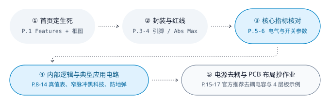
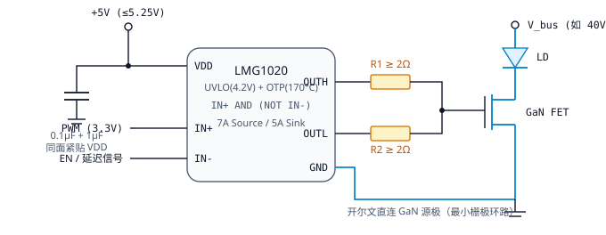
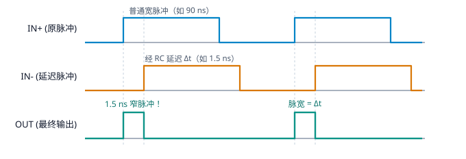
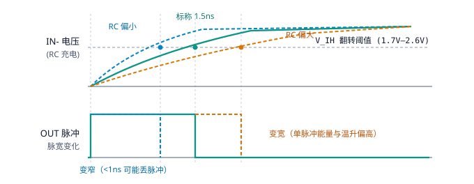

# Day 5：芯片手册阅读方法论与 TI LMG1020 激光驱动实战拆解

拿到几十页全英文的芯片手册（Datasheet）切忌从头逐字通读，工程上应按**“定生死 → 查红线 → 核指标 → 看应用 → 抄布局”**的五步法快速跳读。本篇以激光雷达经典 1 ns 氮化镓驱动芯片 **TI LMG1020** 为实战案例，拆解手册阅读方法、激光驱动核心参数、窄脉冲整形电路以及 RC 延迟容差分析。

---

## 一、高效阅读芯片手册的 5 步黄金路线



1. **首页定生死（P.1）**：看 Features、Applications 和简化框图，30 秒判断电压、电流、频率是否符合项目需求。
2. **封装与极限红线（P.3–4）**：先看 Pin Configuration 确认能不能焊得上，再看 Absolute Maximum Ratings 牢记“碰了必烧”的红线，以及 Recommended Operating Conditions 确认正常工作区间。
3. **电气与开关核心指标（P.5–6）**：核对 UVLO、输入逻辑兼容性、驱动拉灌电流、最小脉宽与传播延迟。
4. **内部逻辑与典型应用（P.8–14）**：吃透真值表、官方典型接法与特殊应用技巧（如防地弹、短脉冲生成）。
5. **电源去耦与 PCB 布局抄作业（P.15–17）**：直接照搬官方推荐的去耦电容组合和多层板 Layout 范例；文末的包装编带和机械尺寸留到画封装、采购贴片时再查。

---

## 二、TI LMG1020 激光驱动核心参数提取表

| 手册章节与页码 | 关键参数 | LMG1020 规格值 | 对激光雷达大创的直接含义 |
| :--- | :--- | :--- | :--- |
| **Sec 6.1 & 6.3** (P.4) | 供电电压 VDD | 推荐 4.75–5.4 V（典型 5 V）；极限 5.75 V | 专为 5 V 氮化镓（GaN）设计；P.8 建议把电源波动控在 5.25 V 以内，留 0.5 V 抗振铃余量 |
| **Sec 6.5** (P.5) | 欠压锁定 UVLO | 典型 4.19 V（回差 85 mV） | 供电低于 4.1 V 时 `OUTL` 自动下拉接地，防止 GaN 半导通烧毁 |
| **Sec 6.5** (P.5) | 输入电平与上下拉 | VIH ≤ 2.6 V，滞回 0.5–1 V；`IN+` 下拉、`IN-` 上拉 | 可直接兼容 3.3 V 单片机 / FPGA；引脚悬空默认安全关断 |
| **Sec 6.5** (P.5) | 峰值驱动电流 | 拉电流 7 A (`OUTH`) / 灌电流 5 A (`OUTL`) | 分离式推挽输出，无需外接二极管即可独立调节开通与关断电阻 |
| **Sec 6.6** (P.6) | 开关速度与脉宽 | 最小脉宽 1 ns、上升 / 下降 375 / 350 ps、延迟 2.5 ns | P.14 实测在 40 V 母线下可驱动 GaN 打出 1.5 ns、60 A 极窄大电流脉冲 |
| **Sec 5 & 12** (P.3, 22) | 封装与焊盘 | 6-Ball WCSP (BGA)，0.80 mm × 1.20 mm（球距 0.4 mm） | 手工烙铁无法焊接，需用热风枪 + 钢网或直接采用嘉立创 SMT 贴片 |

---

## 三、典型激光驱动外围连接与 PCB 避坑（P.10–17）



* **栅极电阻下限（P.10 Sec 8.2）**：TI 明确建议 `OUTH` 与 `OUTL` 各自至少串入一颗 2 Ω 以上的电阻（R1、R2 ≥ 2 Ω），防止寄生电感振铃过冲突破 5.75 V 极限。
* **电源去耦摆放（P.15 Sec 9）**：紧贴 `VDD` 与 `GND` 引脚**同一面**放置 0.1 μF（0402 或三端穿心电容）+ 1 μF（0603）X7R 陶瓷电容，避免过孔寄生电感。
* **必须 4 层板与开尔文回流（P.11–12, P.16）**：第 2 层紧贴顶层铺完整地平面；LMG1020 的 `GND` 必须直接接在 GaN 源极上，**严禁把电流采样电阻串进栅极驱动回流路径**（共源电感压降会直接抵消栅压、拖慢开关速度）。

---

## 四、窄脉冲整形黑科技与 RC 延迟误差分析（P.12–13）

### 1. 用 `IN+` 与 `IN-` 切出 1.5 ns 极窄脉冲

LMG1020 内部逻辑为 `OUT = IN+ AND (NOT IN-)`。将普通宽脉冲（如 90 ns）直接送进 `IN+`，同时将经过 RC 延迟 Δt 的同一路信号送进 `IN-`，芯片仅在两路信号错开的极短窗口内输出高电平，无需昂贵高速 FPGA 即可打出纳秒脉冲。



### 2. 电阻、电容与芯片阈值误差对输出脉宽的影响

RC 延迟产生的脉冲宽度满足：

```math
\Delta t = R \cdot (C_{\text{ext}} + C_{\text{IN}} + C_{\text{PCB}}) \cdot \ln\left(\frac{V_{\text{logic}}}{V_{\text{logic}} - V_{\text{IH}}}\right)
```



| 误差来源 | 典型偏差范围 | 对 1.5 ns 脉宽的影响 | 工程应对措施 |
| :--- | :--- | :--- | :--- |
| **电阻误差** | ±1%（0402 贴片） | ±15 ps（几乎可忽略） | 常规 1% 精度贴片电阻即可 |
| **电容误差** | C0G：±5%；X7R：±10%–25% | ±75 ps ～ ±375 ps | **必须选用 NP0 / C0G 材质**，严禁用 X7R / Y5V |
| **寄生电容** | 引脚 1.3 pF (P.5) + PCB 1–2 pF | +15% ～ +25% 系统偏宽 | 采用**较小 R + 较大 C**（如 33–47 Ω 配 33–47 pF）稀释寄生占比 |
| **芯片阈值离散度（头号误差）** | 1.7 V ～ 2.6 V（手册 P.5） | 最高可达 2 倍脉宽差异，叠加脉宽失真最大 +0.6 ns | 在 RC 后加高速缓冲器整形压低抖动；预留可调电阻焊盘按单板实测微调，或升级为 FPGA 数字延时链 |
