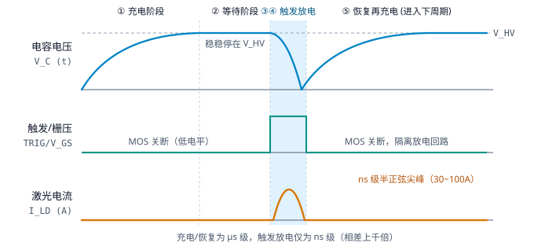
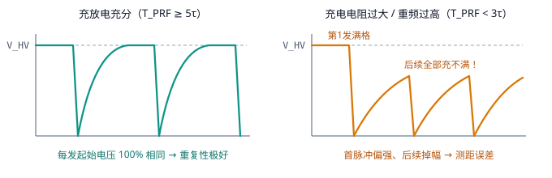
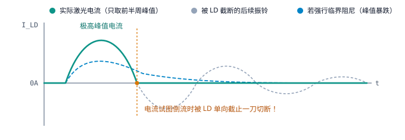
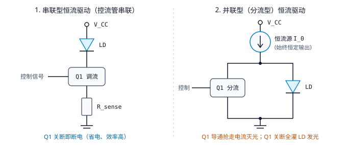
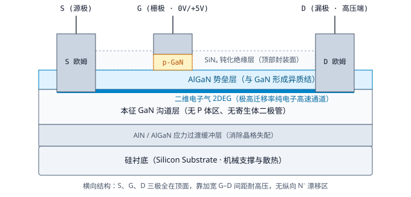
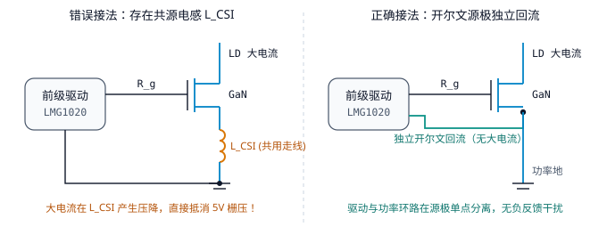
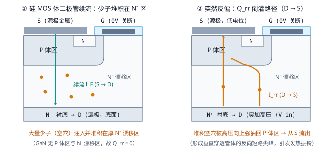

# Day 6：电容放电驱动、恒流驱动拓扑与氮化镓（GaN）高速开关技术

本篇深入总结激光雷达发射端的两大核心驱动架构（**电容放电型脉冲驱动**与**串联/并联恒流驱动**），并全面拆解纳秒级激光驱动核心器件——**增强型氮化镓（eGaN HEMT）的物理结构、零反向恢复特性与驱动铁律**。

---

## 一、电容放电型脉冲驱动：五阶段时序与重复性控制

电容放电型驱动将“慢速蓄能（μs 级）”与“极速释放（ns 级）”彻底解耦，是中长距 dToF 激光雷达的绝对主流。



1. **充电阶段（μs 级）**：开关管关断，高压母线 V_HV 经限流电阻 R_chg 给储能电容 C_store 指数充电。
2. **等待阶段（μs 级）**：电容稳稳停在满电电压 V_HV，等待数字触发信号。
3. **触发阶段（ns 级）**：FPGA / MCU 发出 TRIG，前级驱动瞬间跨过米勒平台导通开关管。
4. **放电阶段（1–10 ns）**：C_store、激光器 LD、开关管与寄生电感 L_loop 发生串联 RLC 欠阻尼放电，砸出 30–100 A 窄脉冲。
5. **恢复阶段（μs 级）**：开关管关断，反并联二极管泄放残余反压，V_HV 再次给电容充回满电进入下一周期。

### 1. 充电回路与“5τ 满充铁律”（决定高频重复性）

充电阶段电容电压满足指数上升规律，时间常数 τ_chg = R_chg × C_store：

```math
V_C(t) = V_{\text{HV}} \left(1 - e^{-\frac{t}{R_{\text{chg}} C_{\text{store}}}}\right), \qquad T_{\text{PRF}} = \frac{1}{\text{PRF}} \ge 5 R_{\text{chg}} C_{\text{store}}
```



* **防止首脉冲效应**：若发射周期 T_PRF 小于 5τ_chg，电容充不满就被迫发射，导致第 1 发满格、后续全部掉幅，破坏测距稳定性。
* **别漏算充电电阻发热**：每次充放电电阻消耗的能量等于电容储能量，平均发热功率如下（高重频时务必选 1206/2512 大功率电阻或多颗并联）：

```math
P_{R_{\text{chg}}} = \frac{1}{2} C_{\text{store}} V_{\text{HV}}^2 \cdot \text{PRF}
```

### 2. 为什么主放电回路要利用“欠阻尼”，却不会一直振铃？

```math
\tau_{\text{pulse}} \approx \pi \sqrt{L_{\text{loop}} C_{\text{store}}}, \qquad I_{\text{peak}} \approx \frac{V_{\text{HV}} - V_{\text{LD}}}{\sqrt{L_{\text{loop}} / C_{\text{store}}}} \cdot e^{-\frac{\pi \zeta}{2\sqrt{1-\zeta^2}}}
```



* **为什么要欠阻尼**：主功率回路追求用最低热损耗砸出最高峰值电流；若强行加电阻调成临界阻尼（ζ = 1），峰值电流会暴跌至 37%（约 1/e），且大部分能量白白烧成热量。
* **为什么只出半个正弦波**：前半周结束后电流试图倒流形成负半周振铃时，**激光二极管（LD）PN 结承受反向偏压、耗尽层拉宽截止**，像单向止回阀一样把后续振铃一刀掐断。
* **工程必加补丁**：因 LD 反向耐压通常仅约 2 V，必须在 LD 两端**反并联一颗高速肖特基二极管 D_prot**，把关断瞬间的负向感应电压钳位在 −0.5 V 以内并安全泄放残余反向能量。
* **高重复性选料铁律**：储能电容必须选**高压 C0G / NP0 材质**（杜绝 X7R 温漂和直流偏置衰减），配合极低 R_DS(on) 的 GaN 管减少温升带来的峰值衰减。

---

## 二、恒流驱动的两大拓扑：串联型 vs 并联分流型



| 对比维度 | 串联型恒流驱动 | 并联型（分流型 / Shunt）恒流驱动 |
| :--- | :--- | :--- |
| **控制方式** | 控流管 Q1 与 LD 串联，直接“卡脖子”调流或断电 | 上方恒流源 I_0 恒定输出，Q1 与 LD 并联：Q1 导通“泄洪”灭光，Q1 关断全灌 LD 发光 |
| **电源电流波动** | 随开关在 0 ↔ I_LD 间剧烈跳变 | **总电流始终恒定为 I_0，几乎零 di/dt 电源噪声** |
| **调制速度** | 中等（每次开关需克服电感重新拉起电流） | **极快**（电流仅在极短并联支路间切换） |
| **功耗与效率** | **效率高**，关断时几乎零功耗 | **效率低**，不发光时 I_0 仍经 Q1 持续耗电发热 |
| **适用场景** | 连续波（CW）激光器、中低频调光、大功率直流驱动 | **高速光通信（Gbps 光模块）**、小电流（几十~几百 mA）超高速低噪声调制 |

---

## 三、氮化镓（GaN）高速开关技术深度拆解

### 1. 增强型 GaN HEMT 完整物理结构



* **横向平面结构**：S、G、D 三极全在顶面，电流沿 AlGaN / GaN 异质结界面天然形成的**二维电子气（2DEG）**水平高速横穿，封装寄生电感低至 < 0.2 nH。
* **p-GaN 帽层实现常关**：栅极下方增加 p-GaN 层，在 V_GS = 0 V 时将正下方 2DEG 耗尽断开，加 +5 V 时恢复贯通导通。
* **G–D 宽间距耐高压**：栅漏间距专门用来承受高压，使米勒电容 C_gd 和栅极总电荷 Q_g 只有同规格硅 MOSFET 的 1/5–1/10。

### 2. 驱动 GaN 必须死守的 4 条铁律与开尔文回流



1. **严守 5 V 栅压窗口**：推荐驱动 5 V、极限仅 6 V，阈值 V_th 极低（1.2–1.8 V），必须使用稳压精准的 5 V 专用驱动 IC（如 LMG1020，自带 4.2 V UVLO）。
2. **开通 / 关断分离栅阻**：开通串 2–5 Ω 压住过冲不破 6 V，关断串 0–2 Ω 强力下拉防止米勒误导通。
3. **开尔文源极独立回流**：栅极充放电回流（通过 C_gs 经位移电流从 S 极返回驱动 IC 的 GND）必须与几十安培主功率放电地**在 GaN 源极单点分离**，彻底消灭共源电感 L_CSI（共用 0.5 nH 在 20 A/ns 下即可感应出 10 V 反向干扰压降，直接冲垮 5 V 栅压）。
4. **4 层板紧耦合布局**：驱动 IC 紧贴 GaN 摆放，第 2 层铺完整地平面利用互感抵消压低回路电感。

### 3. 反向恢复电荷（Q_rr）的物理本质：为什么 GaN 的 Q_rr = 0？



* **硅 MOSFET 为什么有 Q_rr**：垂直功率 MOSFET 内部天然存在由“P 体区 + 厚 N⁻ 漂移区”构成的寄生 PN 结体二极管。续流时大量少数载流子（空穴）注入并堆积在 N⁻ 漂移区；突然反偏关断时，必须先由一股从 D 极垂直穿向 S 极的反向电流把堆积少子强行抽干，形成尖锐的反向恢复电流尖峰 I_rr（面积即 Q_rr），引发严重损耗与高频振铃。
* **GaN 为什么 Q_rr = 0**：横向 GaN 管内部**没有 P 体区、没有厚 N⁻ 漂移区、没有寄生 PN 结体二极管**，正反向导通全程只靠 2DEG 多数载流子（电子）完成，零少子堆积，电压翻转瞬间立刻截止，从物理结构上彻底消灭了反向恢复损耗与振铃源。
