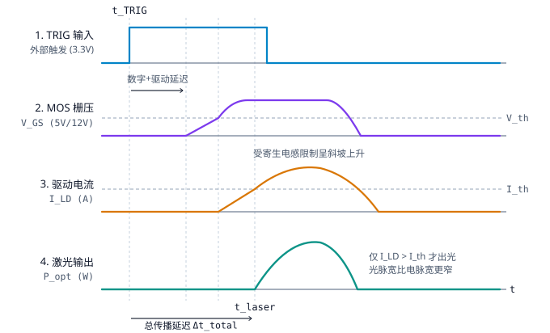
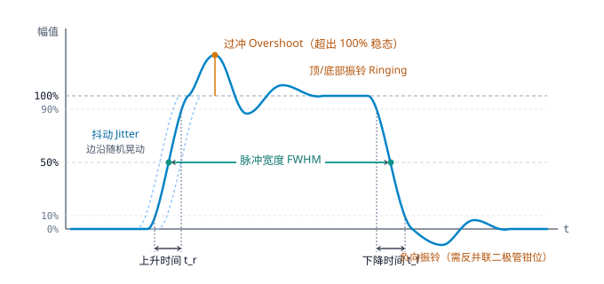
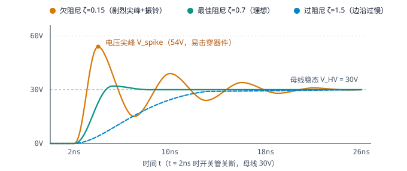

# 脉冲激光驱动的时序控制与六大关键性能指标学习资料

在 dToF 激光雷达中，光往返 $1\text{ m}$ 仅需 $6.67\text{ ns}$。想要测得准、测得远且不烧毁激光器，必须同时掌握**发射链路的时序延迟控制**以及**上升时间、下降时间、脉冲宽度、抖动、过冲、振铃**六大核心指标的物理成因与优化方法。

---

## 一、脉冲驱动的时序控制：为什么 $t_{\text{TRIG}} \neq t_{\text{laser}}$？

激光发射控制链路依次经过：**外部触发 `TRIG` $\rightarrow$ 数字控制模块（FPGA/MCU） $\rightarrow$ 前级驱动（Gate Driver） $\rightarrow$ 功率开关管（GaN/MOSFET） $\rightarrow$ 激光器电流 $I_{\text{LD}}$ $\rightarrow$ 激光光输出 $P_{\text{opt}}$**。

### 1. 四级传播延迟拆解

$$
t_{\text{laser}} = t_{\text{TRIG}} + t_{\text{dig}} + t_{\text{drv}} + t_{\text{MOS}} + t_{\text{LD}}
$$

* **数字控制延迟（$t_{\text{dig}}$）**：`TRIG` 进入 FPGA/MCU 后经过输入缓冲、时钟同步与脉宽整形逻辑产生的时间开销。
* **前级驱动与栅极充电延迟（$t_{\text{drv}}$）**：驱动芯片内部传播延迟，加上给功率管栅极电容 $C_{\text{iss}}$ 充电爬升至开启阈值电压 $V_{\text{th}}$ 的时间。
* **功率回路电流建立延迟（$t_{\text{MOS}}$）**：管子导通后，回路寄生电感 $L_{\text{para}}$ 限制电流斜率（$\frac{di}{dt} = \frac{V}{L}$），电流呈斜坡上升。
* **激光器阈值与动态响应延迟（$t_{\text{LD}}$）**：电流必须跨过激光器阈值电流 $I_{\text{th}}$ 并建立粒子数反转后才真正出光；低于 $I_{\text{th}}$ 的前后两段“裙边”不发光，因此**实际光脉冲宽度天然比电脉冲更窄**。

### 2. 工程上如何保证“定时准、脉宽准”？
* **固定延迟可标定，温漂靠 Start-PD 消除**：固定总延迟可在靶板标定时当零偏扣减；更高精度的方案是在激光器旁增加一颗**发射端光采样二极管（Start-PD）**，直接以“真正出光瞬间”触发 TDC 开始计时，一次性抵消前级所有电路延迟与温漂。
* **脉宽一致性保障**：采用 FPGA 硬件定时器或高速逻辑门+RC 微分电路生成触发脉宽；选用上下沿传播延迟对称的专用前级驱动 IC，并保持 $V_{\text{DD}}$ 与 $V_{\text{HV}}$ 电源纹波极低。

---

## 二、激光脉冲的六大关键性能指标

| 性能指标 | 工程定义 | 典型目标值（dToF） | 对激光雷达系统的核心影响 |
| :--- | :--- | :--- | :--- |
| **上升时间（$t_r$）** | 脉冲从峰值 **10% 升至 90%** 的时间 | $< 1\text{–}2\text{ ns}$ | 越短则回波前沿越陡，**测距精度和分辨率越高** |
| **下降时间（$t_f$）** | 脉冲从峰值 **90% 降至 10%** 的时间 | $< 1\text{–}3\text{ ns}$ | 拖尾太长会拉宽脉宽、增加盲区与芯片发热 |
| **脉冲宽度（FWHM）** | 峰值 **50% 高度处**的前后沿时间差 | $1\text{–}10\text{ ns}$ | 决定单脉冲能量、距离分辨率与**人眼安全（Class 1）** |
| **抖动（Jitter）** | 多次发射间出光时刻的随机偏差（RMS） | $< 50\text{–}200\text{ ps}$ | 直接转化为测距随机噪声（$100\text{ ps} \approx 1.5\text{ cm}$ 误差） |
| **过冲（Overshoot）** | 峰值超过 100% 稳态值的百分比 | $< 10\%$ | 电流过冲易触发激光器 **COD（腔面光学灾变损伤）**；电压过冲易击穿 MOS/GaN |
| **振铃（Ringing）** | 边沿跳变后的高频衰减正弦振荡 | 快速衰减、无二次触发 | 产生强烈 EMI 干扰接收端，负向振铃会反向击穿激光器 |

---

## 三、过冲与振铃的物理机理与阻尼控制

PCB 走线（约 $0.5\text{–}1\text{ nH/mm}$）和引脚构成的寄生电感 $L_{\text{para}}$，与器件结电容、焊盘电容构成的寄生电容 $C_{\text{para}}$，在高速开关激励下形成二阶 RLC 谐振：

$$
V_{\text{spike}} = L_{\text{para}} \frac{di}{dt}, \qquad f_{\text{ring}} = \frac{1}{2\pi\sqrt{L_{\text{para}} C_{\text{para}}}}, \qquad \zeta = \frac{R}{2}\sqrt{\frac{C_{\text{para}}}{L_{\text{para}}}}
$$

* **欠阻尼（$\zeta < 1$，如图中 $\zeta = 0.15$）**：阻尼太小，产生极高的电压尖峰和持久的高频振铃，极易击穿器件或触发接收端误报。
* **最佳阻尼（$\zeta \approx 0.7$）**：兼顾最快的上升/下降时间与极小的过冲，是高速脉冲驱动的理想调试目标。
* **过阻尼（$\zeta > 1$，如图中 $\zeta = 1.5$）**：完全没有振铃，但开关边沿被严重拖慢，不仅测距精度变差，开关管也会因过渡区发热严重而损坏。

---

## 四、大创实战优化清单

1. **压缩功率环路面积（治本）**：将 `C_store` $\rightarrow$ `LD` $\rightarrow$ `Q1` $\rightarrow$ `GND` 紧贴布置在同一面，并在紧邻内层铺完整地平面，把 $L_{\text{para}}$ 压到 $2\text{–}3\text{ nH}$ 以内，同时改善 $t_r$、过冲和振铃。
2. **合理调节栅极电阻 $R_g$**：在驱动输出与 GaN/MOSFET 栅极间串入 $1\text{–}5\text{ }\Omega$ 阻尼电阻，把栅极过冲控制在器件安全耐压内（增强型 GaN 栅压严禁超过 $6\text{ V}$）。
3. **反并联高速续流二极管 $D_{\text{prot}}$**：紧贴激光器两端反并联高速肖特基二极管，彻底钳位关断瞬间的负向振铃电压。
4. **降低抖动（Jitter）**：前级驱动芯片供电脚就近放置低 ESL 陶瓷去耦电容（$0.1\text{ }\mu\text{F} + 1\text{ }\mu\text{F}$），触发信号线远离大电流功率回路以防串扰。
